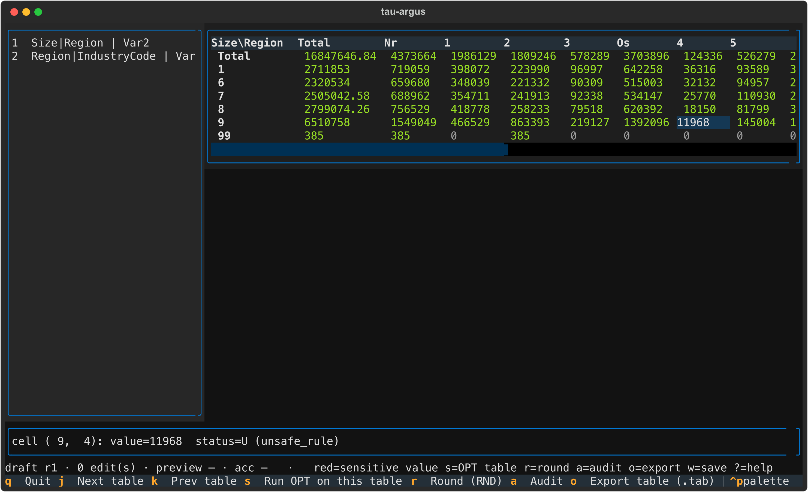
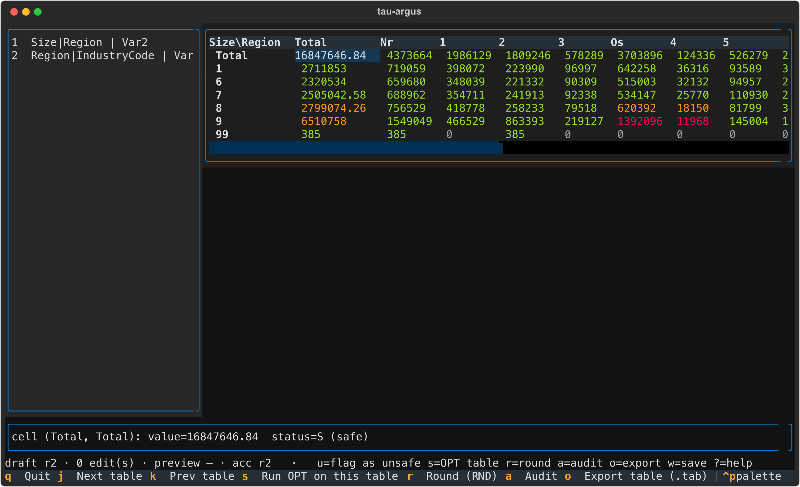
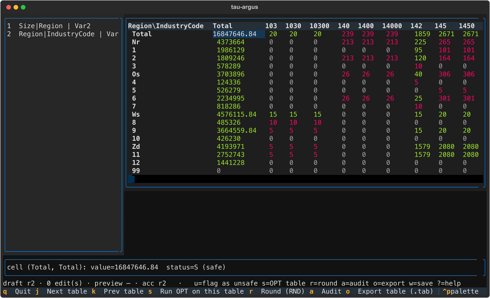
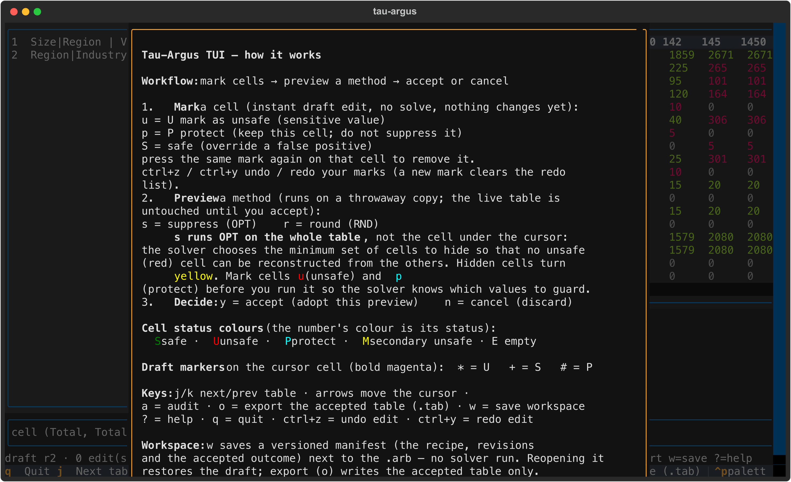

# Tau-Argus TUI — User Guide

`pytauargus-tui` is an interactive **terminal UI** for Tau-Argus: a thin, live
view over the `pytauargus` engine. It is a *presentation layer only* — every
action is a call the headless CLI already makes. It re-implements no engine
behaviour and never touches the native bindings directly.

> Design document: [`docs/ui-design.md`](ui-design.md) (Option B, sections
> §B.1–§B.8). This guide describes what is **implemented today** and what is
> still **outstanding**.

All screenshots below were captured headlessly from the real app (Textual's
test pilot) running against the `data/TestRecode.arb` fixture in this repo.

---

## 1. Install & launch

```bash
pip install pytauargus-tui
# or, as an extra of the engine package:
pip install "pytauargus[tui]"
```

`pytauargus-tui` depends on `pytauargus` (the native engine + `tauargus` CLI)
and `textual`, so one install gives you both the headless CLI and the TUI.

Launch:

```bash
tauargus-tui                 # opens a file browser (below)
tauargus-tui path/to/batch.arb   # opens that .arb batch directly
```

### The file browser (no-argument launch)

With no batch given, a picker opens showing the current directory, filtered
to subdirectories and `.arb` files. `Enter` opens the chosen file, `q`/`Esc`
quits.


---

## 2. Layout



| Region | What it is |
|---|---|
| **Navigator** (left) | One row per `specify_table` in the batch: `index  ExpVars \| RespVar`. Switch tables by clicking a row or `j`/`k`. |
| **Grid** (center) | The computed table: row/column labels from the categorical codes, every cell coloured by its **status**. Move the cursor with the arrow keys. |
| **Detail pane** (bottom, 3 rows) | The cell under the cursor: value, status symbol + full status name, any pending draft mark, and — after an audit — the realised feasibility interval. |
| **Status line** (bottom, 1 row) | The session state and a contextual keymap hint (anatomy in §5). |
| **Footer** (bottom) | The visible key bindings. |

The cursor cell is highlighted; the detail pane and the status-line hint stay
in sync with it.

---

## 3. Cell status colours

The **colour of the number is its status**. The symbol in the detail pane is
the status category letter:

| Colour | Symbol | Category | Meaning |
|---|---|---|---|
| green | `S` | safe | passes all safety rules (or overridden safe, §4) |
| red | `U` | unsafe | a sensitive value — must be protected (hidden or suppressed) |
| cyan | `P` | protect | marked "keep this cell; do not suppress it" |
| yellow | `M` | secondary unsafe | hidden by a suppression so other cells cannot reconstruct a sensitive value |
| dim | `E` | empty | no value (structural or non-structural empty) |
| default | `?` | unknown | status code not recognised |

The full engine status codes (shown by name in the detail pane):

| Code | Name | Category |
|---|---|---|
| 1 | `safe` | S |
| 2 | `safe_manual` | S |
| 3 | `unsafe_rule` | U |
| 4 | `unsafe_peep` | U |
| 5 | `unsafe_freq` | U |
| 6 | `unsafe_zero` | U |
| 7 | `unsafe_singleton` | U |
| 8 | `unsafe_singleton_manual` | U |
| 9 | `unsafe_manual` | U |
| 10 | `protect_manual` | P |
| 11 | `secondary_unsafe` | M |
| 12 | `secondary_unsafe_manual` | M |
| 13 | `empty_nonstructural` | E |
| 14 | `empty` | E |

---

## 4. The workflow: mark → preview → accept

The TUI's core loop is **mark cells, preview a method, then accept or
cancel**. Nothing changes the live table until you accept a preview.

### Step 1 — Mark cells (draft edits, no solve)

With the cursor on a cell:

| Key | Mark | Effect |
|---|---|---|
| `u` | `U` | *require suppression* — flag this value as unsafe (a sensitive value the standard rules missed) |
| `p` | `P` | *protect* — keep this cell; do not suppress it |
| `S` (shift+s) | `S` | *safe (override)* — mark a false positive as safe |

- A mark is an **instant draft edit**: no solver runs and the grid does not
  change. The cursor cell gets a bold magenta **draft marker**
  (`*` = U, `+` = S, `#` = P) and the detail pane shows
  `pending: U (require suppression)` etc.
- Pressing the **same mark again removes it**; a different mark replaces it.
- `Ctrl+Z` / `Ctrl+Y` **undo / redo** marks (a new mark clears the redo list).
- **Total cells cannot be marked** in this iteration (the app logs a message
  and moves on — see *Outstanding*).


Marks tell the solver which values to guard **before** you run it.

### Step 2 — Preview a method (throwaway run)

| Key | Method | What it does |
|---|---|---|
| `s` | **OPT** (cell suppression) | Runs on the **whole table**, not the cursor cell: the solver chooses the *minimum* set of cells to hide so that no unsafe (red) cell can be reconstructed from the others. Hidden cells turn yellow. |
| `r` | **RND** (controlled rounding) | Rounds the table; the rounding base is chosen by the engine. |

The preview runs a full batch on a **throwaway copy** of your `.arb`
(original spec → your draft marks → previously accepted ops → the new op).
The live table is untouched. While the preview runs, a spinner shows in the
status line; when it finishes, the **preview grid replaces the grid** so you
can inspect it, and the status line switches to the pending hint.


### Step 3 — Decide: `y` accept / `n` cancel

- **`y` (accept)** — the preview becomes the working session: its results are
  adopted, your pending marks are promoted to *confirmed*, the undo history
  resets, and the status line records `acc rN` (the accepted revision).
  Accepting also feeds later previews: the next `s`/`r` runs on top of what
  you have accepted so far.
- **`n` (cancel)** — the throwaway is discarded; the live table and your
  draft marks are exactly as they were. A failed preview is dropped to the
  log automatically.



Any new mark after an accept makes the last preview **outdated** (see the
status line below) — the preview is never silently stale.

### A large table

`j`/`k` (or clicking the navigator) switch tables. The second table of the
fixture — 18 rows × 707 columns, 1908 unsafe cells:



---

## 5. The status line

The single line above the footer is composed of, left to right:

```
draft rN · K edit(s) · preview <freshness> · acc rM   ·   <log>   ·   <contextual hint>
```

| Part | Meaning |
|---|---|
| `draft rN` | the draft revision — bumped by every mark/undo/redo |
| `K edit(s)` | number of uncommitted (pending) marks |
| `preview —/fresh/outdated` | no preview yet / preview matches the current draft / the draft changed after the preview was run |
| `acc —/rM` | nothing accepted yet / revision M was accepted |
| `<log>` | the engine log stream (truncated in the middle when the terminal is narrow) |
| `<contextual hint>` | the keymap hint **for the cell under the cursor** |

The hint adapts to the cell kind (legacy §5.6: the apriori letters are
u=unsafe, p=protected, s=safe):

| Cursor on | Hint | Why |
|---|---|---|
| red (U) | `red=sensitive value s=OPT table …` | `s` protects it by hiding the *other* cells that would reconstruct it |
| yellow (M) | `p=keep this cell …` | `p` keeps a hidden cell (do not suppress it) |
| green (S) | `u=flag as unsafe …` | `u` flags a value the standard rules missed |
| otherwise | `u/p/S=mark s=OPT table r=round a=audit o=export w=save ?=help` | the base hint |
| preview pending | `y=accept n=cancel ?=help` | the only time `y`/`n` are live |

The line is always **one row**: state facts left-anchored, hint
right-anchored, the transient log in the middle (truncated with `…` when the
terminal is narrow).

---

## 6. Audit, export, workspace

| Key | Action |
|---|---|
| `a` | **Audit** the current table (legacy `RunAudit`): computes realised feasibility intervals. For the cell under the cursor the detail pane then shows `interval=[min, max]`. Any subsequent edit invalidates the audit. |
| `o` | **Export** the accepted table as a legacy `INTERMEDIATE` `.tab` file to `<arb dir>/out/table_N.tab` (with audit columns when audited). |
| `w` | **Save workspace** — writes a versioned JSON manifest next to the `.arb` (no solver run; works even before any preview). |
| `?` / `F1` | **Help overlay** (below). |
| `q` | Quit. |

### Workspace manifests

`w` writes `<batch-stem>.workspace.json` next to the `.arb`, atomically:

| Field | Content |
|---|---|
| `version` | manifest schema version (currently `1`) |
| `arb` | path to the input `.arb`, as recorded |
| `input_fingerprint` | sha256 of the `.arb` (input-change detection) |
| `draft_revision` / `accepted_revision` | the revision counters at save time |
| `confirmed_ops` | accepted method runs: `{kind: OPT\|MOD\|RND, tab, rnd_base}` |
| `confirmed_instructions` / `pending_instructions` | cell marks: `{table, dim: [labels], kind: U\|S\|P}` |
| `accepted_summary` | per-table status counts of the accepted outcome |
| `provenance` | `{"pytauargus": <version>}` |
| `tab` | the table in focus at save time |

The manifest is a **replayable recipe** — but *reopening* it in the TUI is
not implemented yet (see *Outstanding*).

### Help overlay

`?` (or `F1`) opens the built-in help — the same text is shown in the
screenshot below. Close with `?`/`F1`/`Esc`.



---

## 7. Full key reference

| Key | Action |
|---|---|
| `q` | Quit |
| `j` / `k` | Next / previous table |
| arrow keys | Move the cursor within the table |
| `u` | Mark cursor cell U — require suppression (toggle) |
| `p` | Mark cursor cell P — protect (toggle) |
| `S` (shift+s) | Mark cursor cell S — safe override (toggle) |
| `Ctrl+Z` / `Ctrl+Y` | Undo / redo mark |
| `s` | Preview **OPT** on the whole table |
| `r` | Preview **RND** on the table |
| `y` / `n` | Accept / cancel the pending preview (only live while pending) |
| `a` | Audit the table (feasibility intervals) |
| `o` | Export the accepted table (`.tab`) |
| `w` | Save the workspace manifest (`.workspace.json`) |
| `?` / `F1` | Help overlay |

---

## 8. What is implemented

- `.arb` batch loading (headless engine run) with the file-browser launch.
- Table navigator for multi-table batches; `j`/`k` + click switching.
- Grid rendering with status colours for all 14 engine status codes.
- Live cell detail (value, status, pending mark, audit interval).
- Draft cell marks `u`/`p`/`S` with toggle/replace semantics, undo/redo.
- **Staged preview** of OPT and RND on a throwaway session; per-status delta;
  accept (`y`) / cancel (`n`); freshness tracking (fresh/outdated).
- Audit (realised feasibility intervals) with invalidation on mutation.
- Export of the accepted table as a legacy `.tab`.
- Versioned workspace **save** (atomic, fingerprinted manifest).
- Status line with state facts + contextual hints, always one row.
- Help overlay; spinner while the engine works.
- **68 automated tests** (Textual pilot tests driving the real app, plus
  model and workspace unit tests) — `bindings/tui/tests/`.

## 9. What is outstanding

Tracked against [`docs/ui-design.md`](ui-design.md) §B.7/§B.8:

1. **Workspace reopen / restore (§B.7)** — the biggest gap. The manifest
   module already ships `load_workspace()` and `input_changed()` (tested at
   module level), but the app has **no way to open a `.workspace.json`**: no
   CLI argument, no key. Consequently:
   - reopening a workspace to restore the draft is not wired up (the help
     text's "Reopening it restores the draft" is the forward promise);
   - the saved *accepted outcome* is not displayed on reopen;
   - there is no explicit reconciliation when the input fingerprint changed
     or the manifest version is incompatible;
   - export does not yet *reuse saved accepted artifacts* or record which
     revision was written.
2. **Marking total cells** — explicitly deferred: it needs the real total
   code, which the display label does not preserve. The app blocks the mark
   with a log message.
3. **RND base selection** — the rounding base is always the engine's
   `_min_round_base`; the user cannot choose it (the manifest records
   `rnd_base` so this is ready to grow).
4. **Single session only** — one `.arb` batch at a time; no multi-batch, no
   spec editing, and no replay command in the UI (the "replayable recipe"
   language is the manifest's philosophy until §B.7 lands).

## 10. Screenshot index

| File | State |
|---|---|
| `tui-images/01-file-browser.png` | No-arg launch: the `.arb` file browser |
| `tui-images/02-table0-unsafe.png` | Table 0 loaded, cursor on the unsafe (red) cell |
| `tui-images/03-marked.png` | Draft mark `u` on a safe cell (magenta `*`) |
| `tui-images/04-preview.png` | OPT preview pending (`y`/`n` on the status line) |
| `tui-images/05-accepted.png` | Preview accepted (`acc r2`) |
| `tui-images/06-table1.png` | Table 1: 18 × 707 with many unsafe cells |
| `tui-images/07-help.png` | The help overlay (`?`/`F1`) |

*Captured with Textual's headless test pilot against `data/TestRecode.arb`
(terminal 120×35); convert the SVGs with `rsvg-convert -z 2`.*
